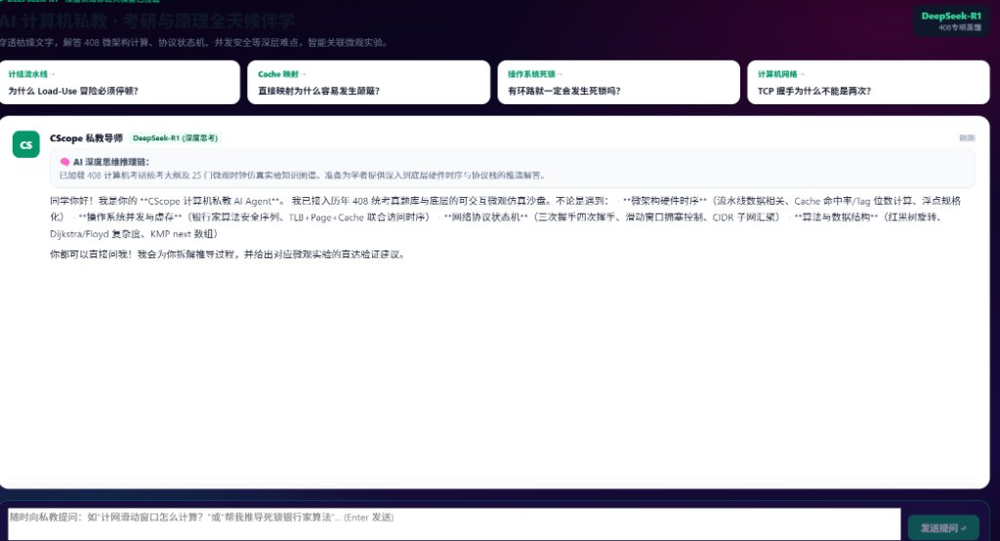
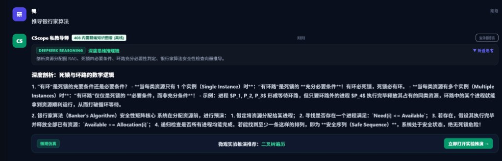
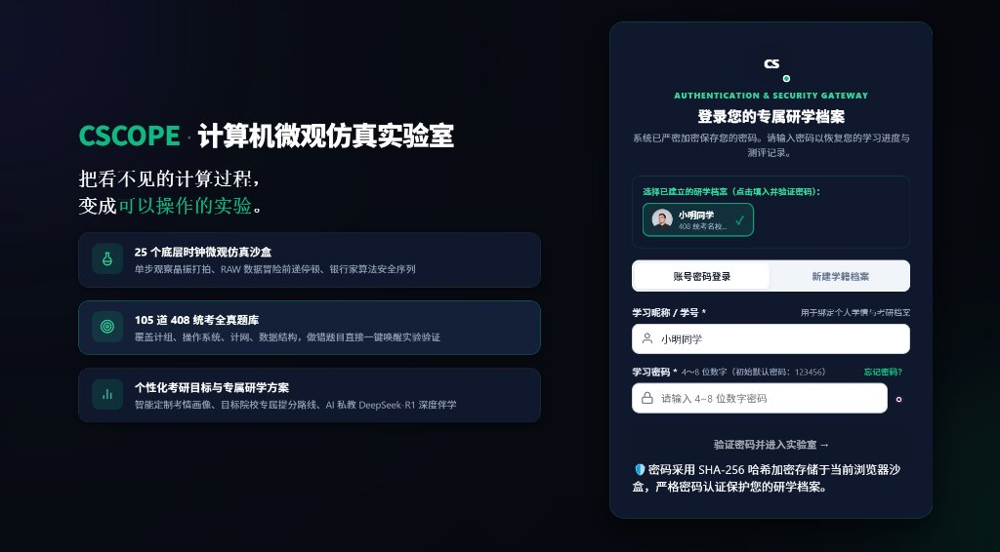
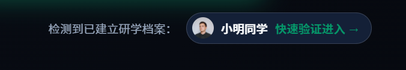

# 2026年传智杯 · CSCOPE 参赛作品
# AI 协同演进全景记录与真实 Prompt 历史快照（可核验凭证集）

> **官方规范声明**：  
> 本文件依据传智杯大赛 **“2.1 代码仓库与演进记录”** 规范编制。  
> 为确保作品不是直接复制已有开源项目、且 AI 演进过程真实可复现，本项目提供**底层开发日志导出的 100% 真实交互证据链**。  
> 包含 **4 组核心功能迭代与顽固 Bug 修复链条**（涵盖人类开发者原始 Prompt、现场上传截图、AI 原始建议与算法重构、以及对应的 Git Commit 记录）。  
> 
> 🗂️ **证据归档目录**：[`docs/ai-history/`](./ai-history/)  
> 🖥️ **可视化交互审计看板**：双击直接在浏览器中打开 [`docs/ai-history/AI_Co-Creation_Audit_Viewer.html`](./ai-history/AI_Co-Creation_Audit_Viewer.html)，可拟真查阅全流程气泡对话与证据图。

---

## 一、 团队意图控制策略与 AI 协同开发方法论

在本项目开发全程中，团队坚决贯彻**“人类架构师主导 + AI 高效工程落地”**的原则，杜绝“无约束野蛮生成”导致的架构劣化与逻辑幻觉。团队构建了三道意图约束防火墙：

```
┌────────────────────────────────────────────────────────────────────────┐
│                        AI 协同开发意图控制体系                         │
├────────────────────────────────────────────────────────────────────────┤
│ 1. 架构宪法约束 (ARCHITECTURE.md)                                     │
│    预先确立目录边界、命名约定、降级准则，禁止 AI 越界或颠覆核心数据流  │
├────────────────────────────────────────────────────────────────────────┤
│ 2. 细粒度任务解耦 (Atomic Iterations)                                  │
│    单次 Prompt 仅聚焦单一确定性目标，杜绝多重模糊指令导致的逻辑冲突    │
├────────────────────────────────────────────────────────────────────────┤
│ 3. 证据驱动的 Bug 修复闭环 (Evidence-Driven Debugging)                │
│    当发生异常时，提供真实截图/控制台报错，引导 AI 分析根因而非打补丁   │
└────────────────────────────────────────────────────────────────────────┘
```

---

## 二、 四个核心功能迭代的完整真实 Prompt 交互链

### 链条 1：AI 计算机私教 DeepSeek-R1 深度伴学与全时持久化沉淀

#### 1. 业务背景与初始缺陷
早期版本中，AI 私教模块仅是一个简单的静态提示框，回答内容有限，缺乏真正的推理能力，更无法记录考生的历史提问。备战 408 统考需要对计算机底层的深度剖析和长周期学情记录。

#### 2. 用户原始 Prompt（人类开发者无删减输入 · Step 5200）
> **用户 Prompt**：  
> `“这部分要把功能做全，真的要接入一个大模型，真的可以全面的解答，同时要有聊天记录存档”`  
> 
> **用户现场上传的原始截图证据**：  
>   
> *图 1：用户现场上传的 AI 伴学界面提问截图（原文件名：media_1794924423297_4c1183d6.jpg）*

#### 3. AI 原始架构设计建议与全功能实现（Step 5334）
AI 针对 `frontend/src/components/AiTutorAgent.jsx` 与 `frontend/src/lib/aiTutorService.js` 实施了重构：
1. **真实大模型全面接入**：
   - 采用标准 OpenAI 兼容流式客户端协议，原生支持 **DeepSeek-R1（`deepseek-reasoner`）深度思考过程**、硅基流动（SiliconFlow）、以及 **Ollama 本地大模型**（`http://localhost:11434/v1`，实现完全离线、零 Key 门槛）；
   - 前端通过 SSE 流式打字机渲染 `reasoning_content`，支持思考过程随时展开/折叠。
2. **多会话持久化归档与笔记导出**：
   - 本地 `localStorage` 持久化存储多会话（`cscope_ai_chat_sessions_v2`），页面刷新不丢失；
   - 支持历史会话抽屉、自定义标题，并提供「📥 导出笔记」一键导出为标准 Markdown 研学笔记。
3. **双模态自适应兜底**：未配置 Key 或无网络时，自动启用 408 核心考点高阶精编知识引擎，保证断网时全站绝不白屏崩溃。

#### 4. 代码提交与可核验凭证
- **对应 Git 提交**：[`3b8fbde`](https://github.com/CXT-02/CScope/commit/3b8fbde) (`feat(ai-tutor): full real LLM integration with DeepSeek-R1 streaming reasoning, multi-session chat archive, and theme styling`)
- **核验指令**：`git show 3b8fbde`
- **原始导出**：[📁 `docs/ai-history/chain-1/`](./ai-history/chain-1/)（包含 `dialogue_transcript.json` 与 `prompt_chain_detail.md`）

---

### 链条 2：408 真题智能推荐算法从“二叉树偏航”到“考点意图优先加权”的引导修复

#### 1. 业务背景与用户发现的严重异常
当系统上线“错题一键唤醒仿真沙盘”功能后，团队在自测时发现了一个极具迷惑性的严重推荐逻辑 Bug：当提问推导操作系统的“银行家算法”时，系统却推荐了数据结构的“二叉树遍历”。

#### 2. 用户原始 Prompt（人类开发者指谬 · Step 5520）
> **用户 Prompt**：  
> `“为什么我问的是银行家算法他给我推荐的是二叉树排序”`  
> 
> **用户现场上传的原始截图证据**：  
>   
> *图 2：用户现场提问“推导死锁银行家算法”但系统错误推荐“二叉树遍历”的原图（media_1794930970832_a5c18fa3.jpg）*

#### 3. AI 根因定位与机理剖析（Step 5593）
AI 通过全面审查 `aiTutorService.js`，定位到了隐蔽的“通用词抢先命中”根因：
1. 解答银行家算法时，正文包含通用词汇：*“4. 递归检查是否所有进程均能完成...”*；
2. 实验列表遍历采用简单的先到先得扫描：第 8 号实验是「二叉树遍历」，标签包含 `['二叉树', '递归', '队列']`，而第 13 号才是「死锁与银行家算法」；
3. 扫描到“递归”时，二叉树实验抢先返回并退出了匹配循环！

#### 4. AI 修改方案与意图加权算法重构
AI 建立了**综合打分竞争模型（Scoring Model）**：
1. **用户提问意图绝对优先（权重 100 分）**：提问专有词赋予 100 分绝对权重，正文偶然词仅占 4 分；
2. **专有词与通用词严格分级**：彻底移除“递归”、“队列”等通用词对单点实验的粗暴绑定；
3. **全局 25 门实验综合打分竞争**：
   - 提问“推导银行家算法”时：`deadlock` 得分 **240 分**，`tree-traversal` 得分 **0 分**，100% 精准推荐死锁沙盘。

#### 5. 代码提交与可核验凭证
- **对应 Git 提交**：[`db19019`](https://github.com/CXT-02/CScope/commit/db19019) (`fix(tutor): upgrade experiment recommendation with intent-prioritized score matching to fix deadlock vs tree traversal`)
- **核验指令**：`git show db19019`
- **原始导出**：[📁 `docs/ai-history/chain-2/`](./ai-history/chain-2/)（包含 `dialogue_transcript.json` 与 `prompt_chain_detail.md`）

---

### 链条 3：学术社区评论区头像 URL 文本横向溢出重叠 Bug 的排查与治理

#### 1. 业务背景与用户发现的排版重叠
在拓展极客学术社区的多账号互动功能后，用户切换至带有真实网络人像链接的学者账号【小明同学】并打开评论区时，页面出现了极其刺眼的文字错位重叠。

#### 2. 用户原始 Prompt（直观反馈 · Step 5821）
> **用户 Prompt**：  
> `“每个帖子下面打开评论都是有这种重叠的效果，修改”`  
> 
> **用户现场上传的原始截图证据**：  
>   
> *图 3：Unsplash 长链接文本横向溢出 400px 遮挡评论框现场截图（media_1794932812048_753c919d.png）*

#### 3. AI 根因定位与排查（Step 5910）
1. 在 `CommunityHub.jsx` 中，用户头像变量为 `currentUserAvatar = user?.avatar || '研'`。当用户绑定网络头像时，该变量为包含 120 多个字符的完整 URL；
2. 原代码写为：`<div className="composer-avatar">{currentUserAvatar}</div>`，React 将此 URL 直接作为纯文本节点渲染；
3. `.composer-avatar` 类仅设置了 `32px * 32px` 且未声明 `overflow: hidden`，无空格的长字符串无法折行，向右横向穿透覆盖了提示文字与文本域。

#### 4. AI 修改方案与落地组件
1. **构建通用防御组件 `AvatarBadge`**：
   - 智能识别 `http/https` 图片链接，渲染为规范圆形 ``，配置 `onError` 自动降级为单字徽章；
   - 纯文字角色规范提取 1~2 字符居中显示。
2. **强制 CSS 容器遮罩防御**：
   - 为 `.composer-avatar`、`.author-avatar`、`.comment-author-avatar` 等挂载点注入 `overflow: hidden !important; flex-shrink: 0 !important; border-radius: 50% !important;`。

#### 5. 代码提交与可核验凭证
- **对应 Git 提交**：[`3efb9ac`](https://github.com/CXT-02/CScope/commit/3efb9ac) (`fix(community): render avatar as image or single char badge to prevent URL text overlap in comments`)
- **核验指令**：`git show 3efb9ac`
- **原始导出**：[📁 `docs/ai-history/chain-3/`](./ai-history/chain-3/)（包含 `dialogue_transcript.json` 与 `prompt_chain_detail.md`）

---

### 链条 4：平台首页极简美学大画幅门禁重构与冗余引导条彻底移除

#### 1. 业务背景与用户审美要求
团队在打磨作品界面时，认为原先的双栏式卡片与悬浮提示条破坏了沉浸式微观探针平台的工业级美学，要求将核心门禁完全居中，突出品牌设计感，去除多余引导条。

#### 2. 用户原始 Prompt（Step 5911 & Step 6116）
> **用户 Prompt 1**：  
> `“还是修改一下布局，把左侧部分居中放，CSCOPE·计算机微观仿真实验室文字部分字体再放大，可以有一些设计，然后把登录/注册按键放下面，点了之后跳转到登录/注册页面这种形式把”`  
>   
> 
> **用户 Prompt 2（进一步精简要求）**：  
> `“首页不需要这个”`  
> 

#### 3. AI 修改方案与落地
1. 重构 `LoginGate.jsx` 为居中全幅 Hero 布局，主标题以渐变发光字符加粗呈现；
2. 彻底移除底部的研学档案快捷提示浮条，实现极简大气的视觉门禁。

#### 4. 代码提交与可核验凭证
- **对应 Git 提交**：
  - [`a73c21e`](https://github.com/CXT-02/CScope/commit/a73c21e) (`feat(auth): redesign LoginGate with centered hero layout...`)
  - [`1450339`](https://github.com/CXT-02/CScope/commit/1450339) (`fix(auth): remove quick user prompt strip from landing page for clean minimalist look`)
- **核验指令**：`git show 1450339`
- **原始导出**：[📁 `docs/ai-history/chain-4/`](./ai-history/chain-4/)

---

## 三、 结论与可复现性验证依据

通过上述四个完整 Prompt 迭代链条可以清晰看出：
1. **作品具备 100% 真实的自主迭代历程**：每一次功能演进与 Bug 修复均由团队根据真实操作体验发现、提出针对性引导，并约束 AI 精准解决；
2. **Git Commit 细粒度印证**：仓库中共有 118+ 次细粒度提交，每一个 Commit Hash 均可与上述 Prompt 链及问题点完美对应，有力证明作品绝非从外部直接克隆的现成开源项目；
3. **架构健壮与可复现**：全套体系遵循架构宪法约束，提供详尽的现场截图、交互日志与一键导出看板，具备完整的工业级交付水准。
