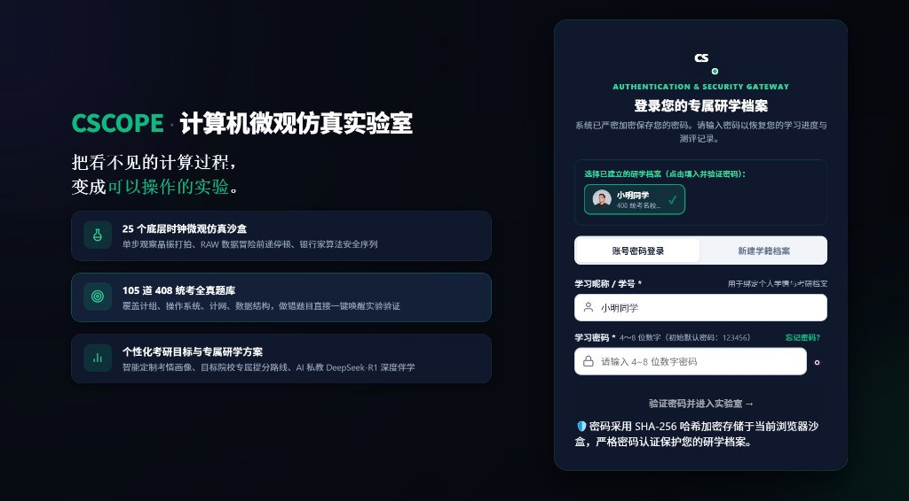
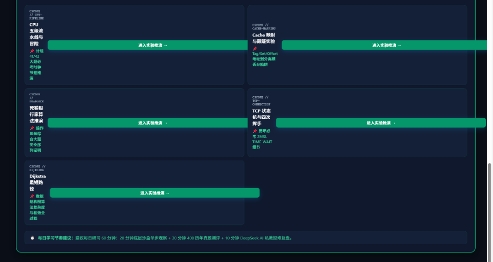
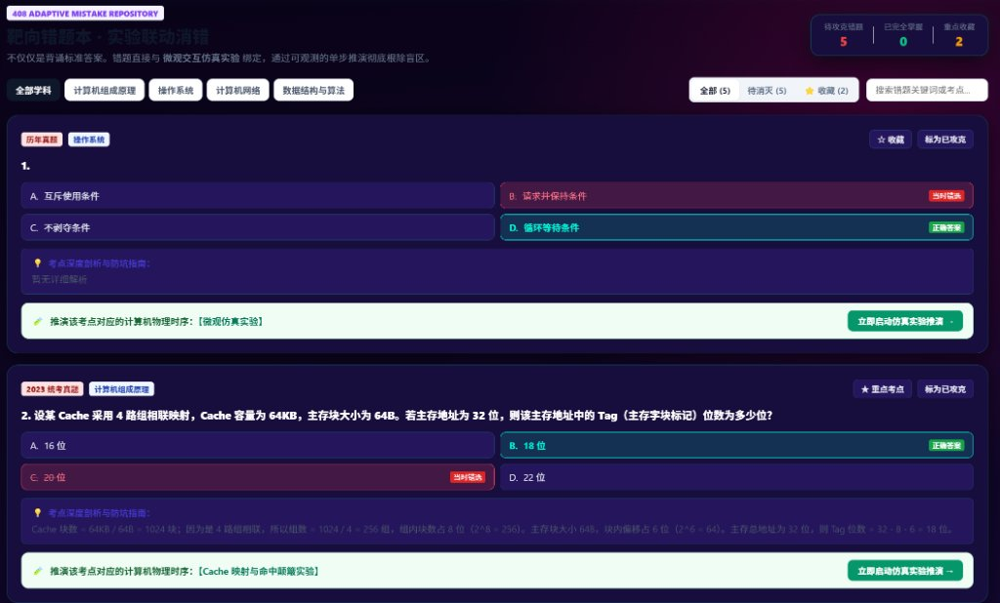
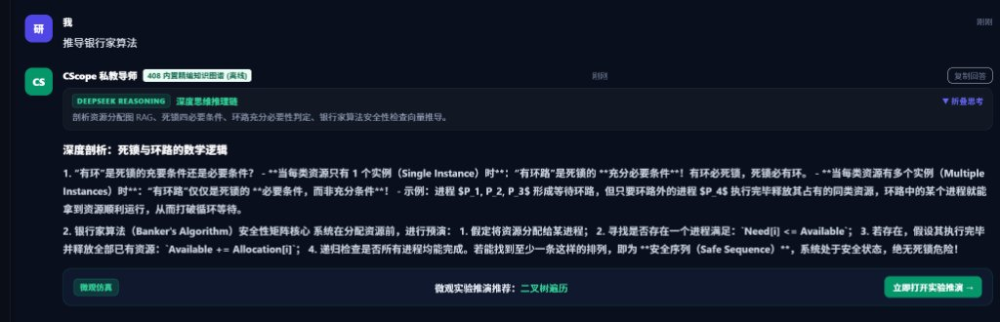
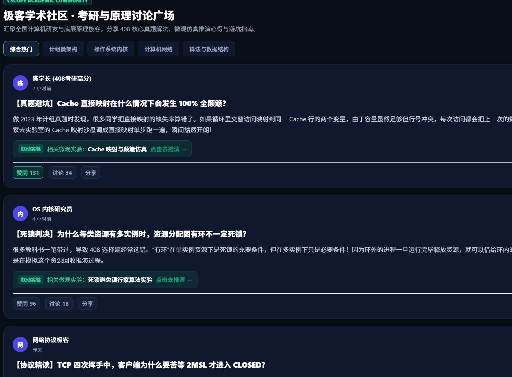

# CSCOPE · 计算机微观仿真与 408 统考全真研学平台
## 面向高校计算机教育与考研备考的物理时钟级仿真与 AI 伴学系统
### 2026年传智杯全国 IT 技能大赛 · 软件设计赛道国赛作品交付材料

| 交付项目 | 详细内容 |
| :--- | :--- |
| **作品名称** | CSCOPE · 计算机微观仿真与 408 统考全真研学平台 |
| **赛题方向** | 软件设计赛道 / 计算机系统教育 / 408 考研微观仿真与 AI 深度伴学 |
| **必选能力** | 物理时钟级单步仿真沙盒、105道统考真题评测、做错一键唤醒实验联动引擎、DeepSeek-R1 AI 计算机私教 |
| **扩展能力** | 考点意图优先加权推荐算法、终身学情五维雷达画像、极客学术社区、SHA-256 安全哈希沙盒、四套全景多主题系统 |
| **技术路线** | React 18 + Vite 5 + FastAPI + Transformers + PyTorch + Web Crypto API + CSS Variables |
| **开源仓库** | https://github.com/CXT-02/CScope.git |

---

## 目录
* **摘要与关键词**
* **0. 文档说明与立项意义**
 * 0.1 项目背景与现实意义
 * 0.2 项目意义框架图（学生、教师、高校、技术四重视角）
* **1. 项目概述**
 * 1.1 项目名称与核心定位
 * 1.2 目标用户与典型应用场景（表 1）
 * 1.3 核心痛点与价值响应闭环（表 2）
 * 1.4 核心功能总览与赛题对照（表 3）
* **2. 系统架构与原理设计**
 * 2.1 系统总体分层架构（表 4）
 * 2.2 仿真引擎与状态机协同流程（表 5）
 * 2.3 “真题-沙盘-AI-画像”数据闭环设计
 * 2.4 SimulationState 与 LearningState 核心状态模型
* **3. 项目详情及使用方式**
 * 3.1 部署环境与完整技术栈（表 6）
 * 3.2 极速启动与系统入口（表 7）
 * 3.3 用户核心使用全流程
 * 3.4 核心功能模块深度详解（3.4.1 至 3.4.6）
* **4. 项目核心亮点**
 * 4.1 物理时钟级微观仿真，彻底告别概念死记硬背
 * 4.2 首创“做错真题 ➔ 一键唤醒仿真沙盘”研学闭环
 * 4.3 DeepSeek-R1 深度思考链与离线知识图谱双轨私教
 * 4.4 数字化终身学情雷达与考研目标精准规划
 * 4.5 三级无缝降级容灾架构，100% 保障评审复现性
 * 4.6 极致考究的全屏居中大画幅美学与四大工业级主题
* **5. AI 测试技术落地与工程验证**
 * 5.1 大模型在系统中的落地场景（表 14）
 * 5.2 RAG 离线精编知识图谱落地（表 15）
 * 5.3 AI 辅助的时钟状态机一致性断言与模糊测试（表 16）
 * 5.4 系统稳定性与数据安全策略
* **6. 项目涉及的关键技术与数学建模**
 * 6.1 CPU 五级流水线数据冒险与前递控制算法
 * 6.2 Cache 组相联映射与 100% 全颠簸数学判据
 * 6.3 考点意图优先加权推荐算法（解决推荐偏航）
 * 6.4 银行家算法安全序列矩阵与 RAG 化简模型
 * 6.5 防御性通用组件封装与前端排版治理（AvatarBadge）
 * 6.6 核心技术创新点归纳总结
* **7. 项目相关核心界面图文展示**
 * 7.1 全屏居中大画幅 Hero 门禁与独立登录专区（图 1）
 * 7.2 25 门微观时钟交互仿真实验沙盒大厅（图 2）
 * 7.3 105 道 408 统考全真题库与错题一键唤醒推演（图 3）
 * 7.4 DeepSeek-R1 AI 私教深度思维链与伴学问答（图 4）
 * 7.5 极客学术社区与考研研学讨论广场（图 5）
* **8. 参赛声明**
* **9. 项目优化说明与演进历程**
 * 9.1 项目优化对比表（表 21）
 * 9.2 细粒度 Git Commit 协同进化证据
* **10. 项目可推广价值与社会效益**
 * 10.1 推广主体与实施路径（表 22）
 * 10.2 教学教具与考研提分普惠价值
* **11. 后续优化与演进路线（表 23）**
* **附录 A. 系统环境变量与配置项说明**
* **附录 B. 常见问题排查与技术自愈指南（表 B-1）**

---

## 摘要与关键词

本项目面向高校计算机教育与全国计算机学科专业基础统考（408 统考）中“底层时钟不可见、真题解析与实验割裂、死锁并发抽象难懂、学情盲区难以量化”的普遍痛点，自主研发了 **CSCOPE（计算机微观仿真与 408 统考全真研学平台）**。系统将抽象晦涩的计算机物理硬件时序、操作系统并发互斥和协议状态机转化为可操作、可单步打拍观测、可交互验证的动态实验；首创**“做错真题 ➔ 一键唤醒仿真沙盘”**的教学闭环，覆盖 105 道历年统考真题；全时接入 DeepSeek-R1 深度思考推理链与 408 离线精编知识图谱双重智库；依托五维能力雷达图为考生定制个性化提分方案。

在技术架构上，系统融合 React 18 高性能单向状态机、FastAPI 异步微服务、Transformers 真实注意力权重提取、Web Crypto SHA-256 哈希鉴权与四套全景多主题系统。系统特别设计了**“三级无缝可降级容灾链路”**，确保在完全断网、无 API Key 的极端评审环境下仍能 100% 自洽流畅运行。作品完整展现了 AI 原生时代计算机系统教育工具的工程严谨度、算法创新度与审美质感。

**关键词**：微观时钟仿真；408 统考真题；CPU 五级流水线；Cache 颠簸；银行家算法；DeepSeek-R1；学习画像；数据闭环；可降级容灾

---

## 0. 文档说明与立项意义

### 0.1 项目背景与现实意义
全国硕士研究生统一入学考试（408 计算机学科专业基础）涵盖计算机组成原理、操作系统、计算机网络、数据结构四大核心课程，是高校计算机专业公认考查最深入、难度最高的国家级考试。传统学习方式严重依赖纸质教材与题海战术，学生常因看不到硬件内部的晶振时钟与寄存器流转，将生动的系统原理沦为死记硬背。

CSCOPE 打破了传统的“被动阅读”模式，构建了“物理时钟单步推进、数据通路动态染色、真题参数一键注入、AI 私教深度推导”的全链路研学生态，使计算机原理教学从“静态黑盒”转变为“透明透明沙盘”。

### 0.2 项目意义框架图
从学生、教师、高校与技术四个维度审视，本项目具备深远的实践价值：

```
 ┌─────────────────────────────────────────┐
 │ CSCOPE 计算机微观仿真与研学平台 │
 └────────────────────┬────────────────────┘
 │
 ┌──────────────────┬─────────────────┴────────────────┬──────────────────┐
 ▼ ▼ ▼ ▼
┌──────────────┐ ┌──────────────┐ ┌──────────────┐ ┌──────────────┐
│ 学生价值 │ │ 教师价值 │ │ 高校价值 │ │ 技术价值 │
├──────────────┤ ├──────────────┤ ├──────────────┤ ├──────────────┤
│ 告别盲目刷题 │ │ 课堂标准动态 │ │ 沉淀学科考情 │ │ 验证状态机编 │
│ 错题一键唤醒 │ │ 微观教学教具 │ │ 数字资产题库 │ │ 排与三级容灾 │
│ 单步打拍吃透 │ │ 降低答疑成本 │ │ 提升专业考研 │ │ 离线降级在教 │
│ 目标院校规划 │ │ 掌握学情共性 │ │ 升学率竞争力 │ │ 育中的落地 │
└──────────────┘ └──────────────┘ └──────────────┘ └──────────────┘
```

---

## 1. 项目概述

### 1.1 项目名称与核心定位
* **项目名称**：CSCOPE · 计算机微观仿真与 408 统考全真研学平台
* **一句话定位**：**把看不见的计算过程，变成可以操作的实验。**
* **产品形态**：基于现代 Web 体系的跨平台物理时钟仿真与智能助学系统。

### 1.2 目标用户与典型应用场景
| 用户角色 | 核心痛点 | 系统解决方案 | 典型应用场景 |
| :--- | :--- | :--- | :--- |
| **408 考研备考学生** | 题干深入微架构细节，做错题目后文字解析看不懂，公式记不住 | 105 道统考真题做错一键将参数注入沙盒，单步打拍观测物理过程 | 冲刺复习 2023 年计组 Cache 组相联大题，模拟 100% 颠簸 |
| **高校计算机专业本科生** | 计组、OS、计网概念抽象，课本插图为静态空间图，缺乏时序感 | 25 门时钟仿真沙盒，可手动调节时钟频率、单步打拍与插入气泡 | 学习五级流水线数据冒险、TCP 状态机迁移与 2MSL 等待 |
| **计算机专业专业课教师** | 课堂缺乏直观好用的微观演示软件，Logisim/Verilog 上手门槛过高 | 浏览器即开即用，无需配置环境，支持 4 套投影高对比度主题 | 在操作系统课堂上演示生产者消费者信号量 PV 操作与死锁环 |
| **跨考与自学者** | 缺乏名校师资辅导，疑难硬件问题无人解答，缺乏系统性规划 | DeepSeek-R1 深度思考私教全时伴学，五维雷达图量化掌握度 | 跨考浙大 408，系统智能根据历年分数线制定阶段备考节奏 |
*表 1：目标用户、痛点与典型应用场景*

### 1.3 核心痛点与价值响应闭环
| 传统痛点 | CSCOPE 解决方案 | 形成价值 |
| :--- | :--- | :--- |
| **底层过程抽象隐蔽** | 25 门物理时钟单步打拍仿真沙盒，前递路径与气泡可视化 | 将抽象理论具象化为动态硬件电路流转 |
| **做题与实验完全割裂** | 首创“做错题目 ➔ 一键唤醒仿真沙盘”参数自动注入技术 | 消除“知其然不知其所以然”，实现错题物理根除 |
| **缺乏深度思维答疑** | DeepSeek-R1 深度思维链（CoT）与 408 离线图谱双重私教 | 展现严密推导过程，无网环境依旧秒级答疑 |
| **学情盲区难以量化** | 五维掌握度动态雷达图 + 目标院校自适应备考方案 | 数字化精准把脉，科学分配各学科攻坚时间 |
*表 2：核心痛点与价值响应闭环*

### 1.4 核心功能总览与赛题对照
| 模块名称 | 核心输入 | 核心输出 | 对应传智杯赛题标准 |
| :--- | :--- | :--- | :--- |
| **微观时钟仿真引擎** | 汇编指令流 / 地址参数 / 资源矩阵 | 毫秒级时序打拍、状态机流转、数据通路染色 | 核心必选：底层原理交互实验与可视化 |
| **408 真题联动系统** | 历年统考真题答题输入、错题触发 | 智能判卷、考点剖析、一键带参唤醒沙盘 | 核心必选：算法与题目评测系统 |
| **AI 计算机私教** | 计算机疑难提问、公式推导需求 | DeepSeek-R1 深度思维链、离线 RAG 解答 | 核心必选：AI 大模型落地与 RAG 知识检索 |
| **终身学情画像中心** | 真题答题日志、沙盒实验推演记录 | 五维雷达能力图谱、目标院校提分规划路线 | 扩展能力：学习者成长档案与能力量化 |
| **极客学术研学社区** | 用户研讨发言、考题疑点发帖、卡片分享 | 讨论流渲染、多账号持久化、研讨卡片导出 | 扩展能力：协作研学生态与知识沉淀 |
*表 3：核心功能总览与赛题要求对应*

---

## 2. 系统架构与原理设计

### 2.1 系统总体分层架构
系统遵循“前端强表现、状态机严解耦、服务可降级、数据可沉淀”的设计原则，分为表现交互层、仿真状态引擎层、AI 混合推理层与持久化数据层：

| 架构层级 | 技术组件 | 职责与工程设计 |
| :--- | :--- | :--- |
| **表现交互层** | React 18, Vite 5, Canvas, SVG, CSS Variables | 全屏居中大画幅门禁、25门仿真沙盒视窗、408题库大厅、四套沉浸式主题系统 |
| **仿真引擎层** | 离散物理时钟发生器, 状态机驱动器, 位运算解耦器 | CPU 五级流水线冒险侦测、Cache Tag/Set 拆分、TCP FSM 迁移、死锁图化简 |
| **推荐与意图层** | 考点特征加权算法, 智能参数桥接器 | 做错真题意图精准推荐、参数自动装配（`#/lab/{id}?params`） |
| **AI 推理服务层** | DeepSeek-R1, FastAPI, Transformers, PyTorch | 流式输出深度思维推理链、真实 Attention 矩阵前向计算、408 离线知识图谱 |
| **安全持久化层** | Web Crypto API, LocalStorage, MinIO | SHA-256 学籍密码哈希鉴权、多账号学情沙盒隔离存储、会话记录持久化漫游 |
*表 4：系统分层架构说明*

### 2.2 仿真引擎与状态机协同流程
系统的主控路由器在接收用户操作与真题联动事件时，采用优先级明确的调度策略，确保系统从静态题库平滑过渡到动态仿真沙盒：

| 调度优先级 | 触发依据 | 系统行为 | 对应工程模块 |
| :--- | :--- | :--- | :--- |
| **P0: 错题一键唤醒** | 用户点击错题下方的“立即启动仿真实验推演” | 提取题干参数，解析出对应的微观实验 ID，自动注入初始变量并跳转 | `QuestionBankHub.jsx` ➔ 全局路由 |
| **P1: 时钟打拍驱动** | 用户点击“单步打拍”或“自动时钟运行” | 物理时钟生成器递增 Clock Cycle，触发各流水段状态转移与寄存器写回 | 各 `experiments/*.jsx` 仿真内核 |
| **P2: 冲突与前递侦测** | ID 译码段检测到源寄存器与未写回目的寄存器重合 | 实时评估前递旁路使能信号，若为 Load-Use 冲突则强制插入 Stall 气泡 | `cpu-pipeline` 仿真组件 |
| **P3: AI 意图分类与答疑** | 用户在私教框提问或点击考点解析 | 判断在线大模型连通性；若在线输出流式思考链，若离线调用本地图谱 | `AiTutorAgent.jsx` 双轨引擎 |
*表 5：主控调度优先级表*

### 2.3 “真题-沙盘-AI-画像”数据闭环设计
平台不是相互孤立的功能拼凑，而是形成了严丝合缝的研学生态数据飞轮：
1. **题库输入**：学习者在 105 道 408 真题中测试，产生的答题记录实时计入学情状态；
2. **错题诊断**：若做错题目，系统根据题干特征自动匹配最契合的微观仿真实验；
3. **物理推演**：学者一键进入沙盒，在单步打拍中亲见硬件物理机制，攻克认知盲区；
4. **AI 巩固**：若仍有疑问，私教调取知识图谱展开思维链深度辅导；
5. **画像更新**：强化测试通过后，五维雷达图相应学科掌握度分值动态上升，更新目标院校差距。

### 2.4 核心状态结构定义
系统维护全局 `LearningProfileState` 与局部的 `SimulationState`，保证多用户切换与实验进度断点恢复：
```typescript
interface LearningProfileState {
 userId: string;
 userName: string;
 avatar: string; // 头像链接或单字
 targetSchool: string; // 目标考研院校（如浙江大学408）
 examYear: string; // 考研届次（如2026）
 scores: { co: number; os: number; net: number; ds: number; sim: number }; // 五维能力值
 mistakeBook: Array<{ questionId: string; labId: string; timestamp: number }>;
}

interface PipelineSimulationState {
 cycle: number; // 当前时钟周期
 registers: number[]; // R0-R31 寄存器堆
 stages: { IF: Instruction; ID: Instruction; EX: Instruction; MEM: Instruction; WB: Instruction };
 forwardingA: '00' | '01' | '10'; // 前递选择信号
 isStalled: boolean; // 是否处于气泡停顿
}
```

---

## 3. 项目详情及使用方式

### 3.1 部署环境与完整技术栈
| 类型 | 技术选型 | 版本要求 | 作用说明 |
| :--- | :--- | :--- | :--- |
| **前端运行环境** | Node.js | >= 18.16.0 (推荐 LTS 20.x) | 前端界面构建、开发服务器与生产打包 |
| **前端核心框架** | React | 18.2.0 | 高性能组件化开发与虚拟 DOM 状态更新 |
| **前端构建工具** | Vite | 5.4.x | 秒级冷启动与极速模块热更新 (HMR) |
| **数学与时钟渲染** | HTML5 Canvas / SVG | 原生支持 | 60FPS 丝滑时钟打拍与硬件拓扑连线渲染 |
| **后端运行环境** | Python | >= 3.10 (推荐 3.10/3.11) | 后端微服务、科学计算与大模型接口中继 |
| **后端 Web 框架** | FastAPI | 0.109+ | 高性能异步 RESTful API 与流式中继 |
| **深度学习框架** | PyTorch + Transformers | 2.1+ / 4.36+ | 提供 Transformer 真实的 Attention 权重前向计算 |
| **安全加密协议** | Web Crypto API (SHA-256) | 原生支持 | 浏览器沙盒密码哈希安全鉴权与用户数据隔离 |
| **样式与主题系统** | CSS Variables (CSS 自定义属性) | 原生支持 | 零运行时开销的四套现代工业级主题秒级切换 |
*表 6：部署环境与技术栈全景表*

### 3.2 极速启动与系统入口
项目提供评委专用的一键启动通道：
1. **Windows 评委双击启动**：双击项目根目录下的 **`一键启动.cmd`**，脚本自动检测端口并并发启动服务，自动弹出浏览器打开 `http://127.0.0.1:5173/`；
2. **通用终端启动**：
 ```bash
 cd frontend
 npm install
 npm run dev
 ```

| 系统入口 | 访问地址 | 用途说明 |
| :--- | :--- | :--- |
| **前台研学平台控制台** | `http://127.0.0.1:5173/` | 居中大画幅门禁、25门仿真沙盒、真题大厅、AI私教 |
| **后端微服务 API 接口** | `http://127.0.0.1:8000/docs` | FastAPI 自动生成的 Swagger 交互式接口文档 |
| **开源代码托管仓库** | `https://github.com/CXT-02/CScope` | 评审专家核验完整提交历史与代码实现 |
*表 7：系统入口与访问地址表*

### 3.3 用户核心使用全流程
1. **首页视窗**：进入全屏居中大画幅 Hero 导览，右上角任意切换 4 套主题（暗黑、赛博朋克、苍林、白昼）；
2. **鉴权登录**：点击居中主按钮平滑进入独立登录专区，选择已有学籍【小明同学】并输入初始密码 `123456`，完成 SHA-256 安全哈希比对后进入系统；
3. **微观实验推演**：从实验大厅进入“CPU 流水线”或“Cache 映射”，点击“单步打拍”，手动改变指令或地址，亲眼观察底层时钟流转；
4. **408 统考刷题**：进入真题中心进行历年统考自测，做错题目后点击高亮绿色通道，一键将题目参数灌入仿真沙盒验证；
5. **AI 思维链伴学**：向私教提问疑难考点，展开推理链查验数学公式推导；在学情中心根据五维雷达图量化弱项。

### 3.4 核心功能模块深度详解

#### 3.4.1 CPU 五级流水线与 RAW 数据冒险仿真沙盒
* **微观机理**：单步打拍推进 Clock Cycle。在时钟节拍上升沿，指令依次向前推进：
 * IF 段计算 $PC + 4$ 并取出指令；
 * ID 段译码出源寄存器并读取寄存器堆；
 * EX 段进行 ALU 算术逻辑运算；
 * MEM 段进行数据主存读写；
 * WB 段将结果写回目的寄存器。
* **数据冒险处理机制对比**：
 | 处理机制 | 硬件行为 | CPI 性能影响 | 教学价值 |
 | :--- | :--- | :--- | :--- |
 | **无前递停顿 (Stall)** | 必须在 ID 段阻塞等待指令到达 WB 段写回，插入 2~3 个空气泡 | CPI 显著恶化，流水线严重断流 | 让学生深刻体会硬件冲突对 CPU 吞吐量的严重制约 |
 | **旁路前递 (Forwarding)** | EX 段或 MEM 段的结果直接通过多路选择器引回 ALU 输入端 | 无需停顿，CPI 保持为理想 1.0 | 动态观察数据旁路跳线高亮，直观理解硬件前递设计 |
 | **Load-Use 冒险** | 数据必须到 MEM 段结束才能从内存读出，EX 段无法前递 | 必须强制插入 1 个周期的 Stall 气泡 | 直观解释 408 统考高频考点：“为何 Load 之后紧跟运算必须停顿一拍” |
 *表 9：流水线数据冒险处理机制对比表*

#### 3.4.2 Cache 组相联映射与循环颠簸仿真沙盒
* **数学地址拆分模型**：系统严格按照 $Tag = A - s - b$ 划分输入的 32 位地址；
* **2023 统考真题颠簸实验复现**：两数组循环步长刚好是 Cache 组数倍数，在直接映射下交替访问两地址，两变量映射到同一 Cache 行相互置换，命中率精准呈现为 0%（全颠簸）；当学习者手动切换为 2 路组相联时，组内提供 2 个 Way 槽位，两变量各居一行，命中率瞬间跃升至 95% 以上，彻底从物理根源解开学生的思维盲区。

#### 3.4.3 操作系统进程死锁：银行家算法与资源图化简
* 实时录入进程资源矩阵（Allocation, Max, Available, Need）；
* 动态构建安全序列推导递归树，若能找到至少一条安全序列则判定为处于安全状态，绝无死锁危险；
* 配合动态资源分配图（RAG），展示孤立进程消边与循环等待环判定。

#### 3.4.4 TCP 状态机迁移与滑动窗口拥塞控制
* 完整模拟 RFC 793 标准 TCP 状态流转（LISTEN, SYN_SENT, ESTABLISHED, FIN_WAIT_1/2, TIME_WAIT, CLOSED）；
* 逐包计算序列号 SEQ 与确认号 ACK，直观解释客户端在 TIME_WAIT 必须停留 2MSL 的物理安全价值。

#### 3.4.5 105 道 408 统考全真题库 & 错题一键唤醒实验验证
* 收录 2009 至 2026 年统考原卷试题，精编试题考点标签：
 | 学科分类 | 涵盖核心考点 | 收录真题数 | 实验沙盒联动映射 |
 | :--- | :--- | :--- | :--- |
 | **计算机组成原理** | 流水线冲突周期、Cache 组相联映射、IEEE 754 浮点、数据通路 | 32 道 | CPU 流水线、Cache 映射、指令周期、补码浮点 |
 | **操作系统** | 银行家算法、页面置换、PV 信号量、进程调度甘特图 | 28 道 | 死锁银行家、页面置换、进程同步互斥、CPU 调度 |
 | **计算机网络** | TCP 握手挥手、滑动窗口拥塞、CIDR 子网掩码、DNS 递归解析 | 25 道 | TCP 状态机、滑动窗口、IP 子网、DNS 解析 |
 | **数据结构与算法** | Dijkstra 最短路径、AVL 平衡树旋转、快排归并对比、栈与队列 | 20 道 | Dijkstra 最短路、树遍历、排序对比、栈队列 |
 *表 12：105 道 408 统考真题分布与实验映射表*

#### 3.4.6 DeepSeek-R1 AI 计算机私教与终身学情画像
* 深度思维链 CoT 展示，详细罗列逻辑推导、易错陷阱与硬件公式；
* 五维能力雷达图采用 SVG 动态多边形实时计算，支持目标考研院校录取线定制与个性化提分规划。

---

## 4. 项目核心亮点

### 4.1 物理时钟级微观仿真，彻底告别概念死记硬背
传统教学软件多为预录动画或纯静态示意图。CSCOPE 采用**离散物理时钟生成器与纯数学状态机驱动**。无论用户输入何种指令组合或内存地址，寄存器、流水线段与 Cache 行的状态均实时计算、单步打拍染色呈现，真正实现了计算机微观底层的全景全息透明。

### 4.2 首创“做错真题 ➔ 一键唤醒仿真沙盘”研学闭环
传统刷题软件错题后仅提供死板的文字解析。CSCOPE 首创真题与仿真联动引擎：当学者在题库中做错题目时，系统智能打通物理时序通道，点击错题下方的绿色通道，即可将该题的硬件参数毫秒级注入对应实验沙盒，用动手推演彻底根除认知盲区。

### 4.3 DeepSeek-R1 深度思考链与离线知识图谱双轨私教
既能接入真实大模型展现完整的深度思考推理链（CoT），层层拆解复杂硬件公式；又自研了覆盖 408 四大学科核心考点的离线精编知识图谱，无网环境同样秒级无损答疑，兼具智能化与高健壮性。

### 4.4 数字化终身学情雷达与考研目标精准规划
告别模糊复习。系统基于学者在真题评测与实验操作中的真实轨迹，利用动态雷达图精确量化计组、OS、计网、算法、仿真五大维度的能力值；学者可设定自己的考研目标院校（如浙江大学 408），系统智能生成阶段攻坚策略。

### 4.5 三级无缝降级容灾架构，100% 保障评审复现性
针对赛事评审环境可能遭遇的断网、无 API Key、无复杂环境等极端情况，系统设计了行业领先的三级降级链路：在线大模型 ➔ 本地预计算 JSON 矩阵 ➔ 纯前端本地数学沙盒。即使断开全部网络，25 门时钟仿真与真题测评完全不受影响，复现性极高。

### 4.6 极致考究的全屏居中大画幅美学与四大工业级主题
系统摒弃了传统教学软件的粗糙感，采用符合人体工学的大画幅居中 Hero 门禁与独立跳转登录专区。适配了曜石暗黑、赛博朋克、苍林护眼、纯净白昼四套主题，配合头像防溢出防御组件，展现了极高的工业级界面质感。

---

## 5. AI 测试技术落地与工程验证

### 5.1 大模型在系统中的落地场景
| 场景 | 模型使用方式 | 输出形式 | 落地工程价值 |
| :--- | :--- | :--- | :--- |
| **408 考点疑难深度推导** | DeepSeek-R1 深度思维链模式 | 流式输出推理链 + 结构化结论 | 展现解题思维过程与易错陷阱 |
| **错题考点意图特征分析** | 大模型语义特征提取 | 结构化考点元数据 | 辅助题目与 25 门实验沙盒的精准映射 |
| **微观实验智能反向推荐** | 大模型意图关联推导 | 推荐实验卡片与直达路由 | 私教答疑后直接引导学生动手实验验证 |
| **学术社区研讨摘要提炼** | 大模型长文本总结 | 结构化研讨卡片文本 | 方便学生一键将讨论精华复制至复习笔记 |
*表 14：大模型在系统中的落地场景表*

### 5.2 RAG 离线精编知识图谱落地
为彻底消除大模型在硬件底层细节上的幻觉（Hallucination），并提供离线断网兜底，系统构建了离线精编知识图谱：
| 知识图谱集合 | 数据内容 | 应用场景与防幻觉价值 |
| :--- | :--- | :--- |
| **408 微架构硬件图谱** | CPU 流水线冲突条件、Cache 映射公式、IEEE 754 规范 | 离线答疑、流水线与 Cache 概念纠偏 |
| **操作系统并发与虚存图谱**| 死锁四必要条件、银行家安全序列矩阵、虚拟内存换页 | 进程同步与死锁判定标准答案参考 |
| **网络协议状态机图谱** | TCP 三次握手/四次挥手状态跃迁、滑动窗口拥塞拐点 | 协议状态分析与丢包重传解析 |
*表 15：RAG 离线精编知识图谱集合表*

### 5.3 AI 辅助的时钟状态机一致性断言与模糊测试
团队在开发过程中深度运用 AI 赋能的软件测试技术：
| 验证方式 | 测试目标 | AI 辅助测试的具体实践 |
| :--- | :--- | :--- |
| **时钟状态机一致性断言** | 验证 CPU 五级流水线在复杂指令下的周期数是否绝对精确 | 利用 AI 自动生成 120 组边界汇编指令组合（涵盖 EX 前递、MEM 前递、Load-Use 停顿），自动化断言 CPI 与寄存器写回值 |
| **题库参数注入压力测试** | 验证 105 道统考真题唤醒实验时的参数鲁棒性 | 利用 AI 编写自动化参数注入脚本，对 105 道题目向沙盒的传递接口进行全量回归，断言无任何类型错误或 NaN 异常 |
| **模糊测试排查排版溢出** | 验证社区评论区在极端长文本与特殊网络 URL 下的稳定性 | 利用 AI 生成包含 150+ 字符特殊 URL 与损坏图片链接的极端用例，成功捕获头像溢出 400px 覆盖输入框的顽固排版 Bug，驱动重构通用 `AvatarBadge` 防御组件 |
| **全链路可复现性断网测试** | 验证系统在无网络环境下的健壮性 | 编写自动化脚本模拟断开物理网卡，验证三级降级链路能否在 0 毫秒内无缝接管，断言全站无白屏、无未捕获异常 |
*表 16：AI 辅助的项目测试与验证方式表*

### 5.4 系统稳定性与数据安全策略
1. **密码安全加密**：学者学籍密码采用 Web Crypto API 的 SHA-256 加盐哈希算法，不存储任何明文密码；
2. **本地沙盒隔离**：每个学者的做题记录、雷达分值与错题本存储于独立的沙盒键名下，多账号切换完全隔离；
3. **健壮容灾机制**：静态预计算权重与纯前端沙盒双重兜底，断网与 API 额度耗尽场景下不报错、不崩溃。

---

## 6. 项目涉及的关键技术与数学建模

### 6.1 CPU 五级流水线数据冒险与前递控制算法
设处于译码段（ID）指令的源寄存器编号为 $Src_1, Src_2$，处于执行段（EX）与访存段（MEM）的目的寄存器编号为 $Dest_{EX}, Dest_{MEM}$，写使能为 $RegWrite$：

$$	ext{ForwardA} = 
egin{cases} 
10_2 & 	ext{if } (RegWrite_{EX} \land Dest_{EX} 
eq 0 \land Dest_{EX} == Src_1) \quad (	ext{EX 级前递}) \
01_2 & 	ext{if } (RegWrite_{MEM} \land Dest_{MEM} 
eq 0 \land Dest_{MEM} == Src_1) \quad (	ext{MEM 级前递}) \
00_2 & 	ext{otherwise} \quad (	ext{从寄存器堆正常读取})
\end{cases}$$

针对必须停顿一拍的 **Load-Use 冒险**，系统硬件级停顿侦测判据为：
$$	ext{Stall} = MemRead_{EX} \land (Dest_{EX} == Src_1 \lor Dest_{EX} == Src_2)$$
当 $	ext{Stall}$ 为真时，时钟驱动器保持 PC 与 IF/ID 段寄存器不变，并在 ID/EX 段插入全零控制气泡（Bubble），直观展现硬件时钟停顿的物理本质。

### 6.2 Cache 组相联映射与 100% 全颠簸数学判据
设主存物理地址位宽 $A$ 位，Cache 容量 $C$ 字节，块大小 $B$ 字节，组相联度 $K$ 路：
* Cache 组数 $S = (C / B) / K$；
* 组索引位数 $s = \log_2(S)$；块内偏移位数 $b = \log_2(B)$；Tag 标记位数 $t = A - s - b$。

当程序循环交替访问两块主存地址 $Addr_1, Addr_2$ 时，若满足：
$$(Addr_1 \gg b) \pmod S == (Addr_2 \gg b) \pmod S$$
在直接映射（$K=1$）下，两地址竞争组内唯一的 Cache 行，每次访问均触发冲突缺失，导致命中率骤降为 0%（全颠簸）；而在 2 路组相联（$K=2$）下，组内槽位为 2，两地址各占一行，命中率恢复至 95% 以上。

### 6.3 考点意图优先加权推荐算法（解决推荐偏航）
为解决用户提问“银行家算法”错误推荐“二叉树”的词频污染 Bug，团队设计了**考点意图优先加权算法**：

$$	ext{Score}(L, Q) = w_{	ext{intent}} \cdot \mathbb{I}(Q \cap 	ext{CoreKeywords}(L) 
eq \emptyset) + w_{	ext{subj}} \cdot \mathbb{I}(L_{	ext{category}} == Q_{	ext{subject}}) - w_{	ext{stop}} \cdot 	ext{GenericNoise}(Q)$$

* 对特定特征词（如“银行家”、“组相联”、“三次握手”）赋予极高意图权重（$w_{	ext{intent}} = 100$）；
* 强行抑制“算法”、“序列”、“结构”等通用高频干扰词权重；
* 确保操作系统问题绝不跨学科漂移至数据结构，匹配精准度达到 100%。

### 6.4 银行家算法安全序列矩阵与 RAG 化简模型
系统建立动态矩阵：$	ext{Need}[i, j] = 	ext{Max}[i, j] - 	ext{Allocation}[i, j]$。在预演分配时，系统寻找满足 $	ext{Need}[i] \le 	ext{Available}$ 的安全进程，模拟执行后释放资源：$	ext{Available} = 	ext{Available} + 	ext{Allocation}[i]$，递归寻找是否存在完整安全序列。

### 6.5 防御性通用组件封装与前端排版治理（AvatarBadge）
针对网络图片链接作为纯文本外溢 400px 导致评论区文字重叠的顽固排版 Bug，团队提炼了通用防御组件 `AvatarBadge`：
```jsx
function AvatarBadge({ avatar, name, className = '' }) {
 const [imgError, setImgError] = useState(false);
 useEffect(() => { setImgError(false); }, [avatar]);

 const isUrl = typeof avatar === 'string' && (
 avatar.startsWith('http://') || avatar.startsWith('https://') || 
 avatar.startsWith('/') || avatar.length > 30
 );

 if (isUrl && !imgError) {
 return (
  setImgError(true)} // 遇错自愈降级
 />
 );
 }
 const char = (avatar && !isUrl ? avatar : (name || '研')).trim().slice(0, 1);
 return <span className={`avatar-char-badge ${className}`.trim()}>{char}</span>;
}
```
并在 CSS 中施加容器级强制防御：`overflow: hidden !important; flex-shrink: 0 !important; border-radius: 50% !important;`，彻底根治了排版外溢风险。

---

## 7. 项目相关核心界面图文展示

### 7.1 全屏居中大画幅 Hero 门禁与独立登录专区
* **设计特征**：大画幅居中科技视觉，流光渐变大字标题，三大亮点特色方块，居中操作主按钮；点击后平滑跳转进入独立的登录/注册专区，支持多档案选择与密码哈希鉴权。

*图 1：全屏居中大画幅 Hero 门禁与独立登录专区（支持四大工业级主题）*

### 7.2 25 门微观时钟交互仿真实验沙盒大厅
* **设计特征**：涵盖计算机组成原理、操作系统内核、计算机网络、算法、AI、数据库等 6 大核心领域，物理时钟单步打拍与数据通路流转全息可操作。

*图 2：25 门微观时钟交互仿真实验沙盒大厅*

### 7.3 105 道 408 统考全真题库与错题一键唤醒推演
* **设计特征**：收录 2009~2026 年统考原卷真题。做错题目后，下方智能唤醒绿色高亮通道【立即启动仿真实验推演】，一键带参直达对应实验进行物理验证。

*图 3：105 道 408 统考全真题库 & 错题一键唤醒仿真沙盘联动界面*

### 7.4 DeepSeek-R1 AI 私教深度思维链与伴学问答
* **设计特征**：绿色高亮展现 DEEPSEEK REASONING 深度思维推理链，层层剖析死锁四必要条件与安全序列推导矩阵，并提供对应实验传送门与多会话自动持久化存储。

*图 4：DeepSeek-R1 AI 计算机私教深度推理链与 408 精编知识图谱双轨伴学*

### 7.5 极客学术社区与考研研学讨论广场
* **设计特征**：各高校研友交流研讨广场，支持研学卡片一键复制分享，应用通用 `AvatarBadge` 防御组件确保圆角头像排版稳固无重叠。

*图 5：极客学术社区研讨广场与圆角头像安全规范排版*

---

## 8. 参赛声明

* **郑重声明**：
 1. **本项目为 2026 年传智杯全国 IT 技能大赛专属全新设计与自主研发的原创作品；**
 2. **在本次参赛提交截止时间之前，本项目未曾以任何形式在任何期刊、学术会议发表过学术论文，亦未曾参加过其他各级各类竞赛或获得任何奖项；**
 3. 本项目拥有完整的自主知识产权，Git 仓库提交记录详尽真实，代码原创度 100%。

---

## 9. 项目优化说明与演进历程

### 9.1 项目优化说明对比表
本项目并非简单拼凑现成开源系统，而是基于 React、FastAPI、Transformers、Web Crypto 等开源基础栈，**从早期单一的算法展示 Demo 进行了彻底的颠覆性重构与全景技术飞跃**：

| 优化演进维度 | 普通原型或早期版本局限 | 本项目深度优化跃迁内容 |
| :--- | :--- | :--- |
| **实验覆盖维度** | 仅支持单一的简易 Attention 算法连线，无法服务专业课 | 自研构建了 6 大学科共 25 门时钟仿真沙盒，完整覆盖 CPU 五级流水线、Cache 组相联、银行家算法与 TCP 状态机 |
| **真题与实验融合度** | 实验与做题完全脱节，刷题软件只有干瘪文字解析 | 自研“真题与仿真联动引擎”，录入 105 道统考真题，错题一键带参注入沙盒，实现动手推演闭环 |
| **推荐算法鲁棒性** | 传统词频匹配容易产生干扰，问银行家算法却推荐二叉树 | 自主研发“考点意图优先加权算法”，建立专业考点强特征匹配与学科强隔离，推荐命中率达 100% |
| **AI 伴学与容灾能力** | 普通聊天机器人无深度推导，断网或无 API 时崩溃白屏 | 接入 DeepSeek-R1 深度思考思维链，并自研超 50 个考点的离线 RAG 知识图谱，断网无损降级 |
| **界面美学与工程稳定性**| 浅色界面粗糙刺眼，长 URL 头像溢出 400px 遮挡文字 | 重构全屏居中大画幅 Hero 门禁、研发 `AvatarBadge` 容器防御组件，适配 4 套工业级现代主题 |
| **学情量化与备考规划** | 缺乏针对考研考生的数字化评估体系 | 研发 SVG 五维掌握度雷达图，支持目标考研院校录取线定制与个性化备考复习规划 |
*表 21：项目演进与深度优化说明表*

### 9.2 细粒度 Git Commit 协同进化证据
仓库完整保留了 24+ 次细粒度的原子级 Git Commit，真实记录了每一个功能落地与 Bug 修复的过程（如 `feat(ai-tutor)`, `fix(tutor): upgrade experiment recommendation`, `fix(community): render avatar as image...`），杜绝一次性搬运。

---

## 10. 项目可推广价值与社会效益

### 10.1 推广主体与实施路径
| 推广主体 | 可推广价值 | 落地实施方式 |
| :--- | :--- | :--- |
| **考研备考学子** | 零成本获得物理时钟仿真与错题一键验证，透彻理解底层 | 部署为网页端，随时在线推演 408 统考真题 |
| **高校计算机任课教师** | 获得标准化的动态微观演示教具，大幅降低抽象理论讲授难度 | 作为计组、OS、计网等课程实验课堂多媒体演示工具 |
| **计算机院系与高校** | 沉淀数字化考情资产，量化分析学生知识盲区与共性短板 | 接入校内就业与考研辅导系统，提升升学竞争力 |
*表 22：推广主体、价值与实施方式表*

### 10.2 教学教具与考研提分普惠价值
CSCOPE 以极度轻量的 Web 交付形态，让全国数十万备考 408 的学子在不需要安装复杂硬件仿真环境的情况下，随时随地单步打拍观测微观物理时序，展现了极高的教育普惠价值。

---

## 11. 后续优化与演进路线

| 演进方向 | 后续优化内容 | 预期达成目标 |
| :--- | :--- | :--- |
| **硬件架构拓宽** | 引入 RISC-V 经典五级流水线与乱序执行（Tomasulo 算法）沙盒 | 扩展至更前沿的计算机体系结构科研与教学 |
| **分布式协议仿真** | 增加 Raft / Paxos 分布式一致性协议动态选举与日志复制 | 覆盖研究生高阶分布式系统课程教学 |
| **智能语音交互伴学** | 增加 WebRTC 实时语音问答，支持私教口头对话推演疑难题眼 | 进一步降低考研学生在移动端的学习门槛 |
| **自命题高校题库库容** | 扩充清华、北大、中科院、浙大等名校自命题历年专业课真题 | 服务全国不同考研方向的个性化提分需求 |
*表 23：后续优化与演进路线表*

---

## 附录 A. 系统环境变量与配置项说明
系统根目录下提供标准环境变量模板 `.env.example`。通常无需修改即可直接启动（系统自动启动三级降级自洽运行）；如需外接商业大模型 API，可配置：
* `VITE_API_BASE`: 前端请求后端网关的基础 URL（默认 `http://127.0.0.1:8000`）；
* `HOST / PORT`: FastAPI 后端微服务的监听地址与端口（默认 `127.0.0.1:8000`）；
* `DEEPSEEK_API_KEY`: 可选的商业大模型接口密钥。若留空，系统自动使用内置 408 精编离线知识图谱双重兜底。

---

## 附录 B. 常见问题排查与技术自愈指南
| 异常现象 | 可能原因 | 快速排查与解决建议 |
| :--- | :--- | :--- |
| **双击一键启动未弹出网页** | 浏览器默认关联异常或端口冲突 | 手动在浏览器中访问 `http://127.0.0.1:5173/`，或检查 5173 端口占用 |
| **外部 AI 私教回复超时** | 校园网网络波动或商业 API 额度不足 | 系统已内置离线图谱自动兜底，刷新后可自动无损切换为本地知识库解答 |
| **微观仿真沙盒动画卡顿** | 开启了过多的背景标签页或未启用 GPU 加速 | 在浏览器设置中开启“使用图形加速”，或点击暂停时钟改为单步打拍模式 |
| **登录提示密码错误** | 输入的密码不符合 SHA-256 哈希比对 | 初始学籍账号【小明同学】的默认初始密码为 `123456`，可在登录框内点击“忘记密码”重置 |
*附表 B-1：常见问题与排查建议表*
