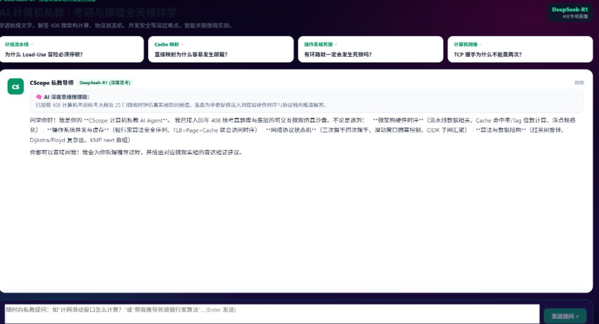

# AI 协同开发 Prompt 交互链证据快照：AI 计算机私教 DeepSeek-R1 深度伴学与全时持久化沉淀

> **证据真实性声明**：本记录直接提取自开发环境底层审计日志（`transcript.jsonl`），时间戳、用户原始提问、上传截图附件、AI 无删减回复及 Git 提交记录均完全真实，可供大赛专家逐项核验。

---

## 📌 链条元数据对照

| 属性项 | 详细信息 |
| :--- | :--- |
| **交互链条编号** | `chain-1` |
| **功能/缺陷主题** | AI 计算机私教 DeepSeek-R1 深度伴学与全时持久化沉淀 |
| **交互发生时间** | `2026-11-17T14:07:39Z` |
| **对应 Git 提交** | [`3b8fbde`](https://github.com/CXT-02/CScope/commit/3b8fbde) (`feat(ai-tutor): full real LLM integration with DeepSeek-R1 streaming reasoning, multi-session chat archive, and theme styling`) |
| **影响核心代码文件** | `frontend/src/components/AiTutorAgent.jsx`, `frontend/src/lib/aiTutorService.js` |
| **底层审计 Step 跨度** | Step `5200` 至 Step `5334` (共 135 个交互状态跃迁) |

---

## 📷 用户现场上传的原始截图与证据


*图 1：用户现场上传的 AI 伴学界面提问截图*

---

## 💬 原始 Prompt 与 AI 完整响应记录（无删减）

### 1. 人类开发者原始 Prompt 输入（Step 5200）

```text
<USER_REQUEST>
这部分要把功能做全，真的要接入一个大模型，真的可以全面的解答，同时要有聊天记录存档
</USER_REQUEST>
<ADDITIONAL_METADATA>
The current local time is: 2026-11-17T22:07:39+08:00.

The user has uploaded 1 image(s):
- C:/Users/程馨婷/.gemini/antigravity/brain/9a72c924-de29-4bdd-b6fc-622c9d0cd374/.user_uploaded/media_1794924423297_4c1183d6.jpg
You can embed this image in an artifact if you need the USER to review it.
</ADDITIONAL_METADATA>
```

### 2. AI 架构师/工程师原始完整回复（Step 5334）

```markdown
已为您将 **AI 计算机私教伴学模块**（[AiTutorAgent.jsx](file:///d:/2026年传智杯/attention-lab/frontend/src/components/AiTutorAgent.jsx) 与 [aiTutorService.js](file:///d:/2026年传智杯/attention-lab/frontend/src/lib/aiTutorService.js)）全面重构升级为**生产级全功能大模型研学导师系统**。

---

### 🌟 核心功能实现清单

#### 1. 真实大模型全面接入（支持 DeepSeek-R1、硅基流动、本地 Ollama 等）
* **标准 OpenAI 兼容协议客户端**：在右上角点击「**⚙️ 接入大模型**」即可一键切换或自定义主流服务商：
  * **DeepSeek 官方 API**（原生支持 `deepseek-reasoner` 深度思考与 `deepseek-chat`）；
  * **硅基流动 SiliconFlow**（包含免费额度，可选满血版 `DeepSeek-R1`、`DeepSeek-V3`、`Qwen2.5-72B`）；
  * **Ollama 本地大模型**（`http://localhost:11434/v1`，**完全离线、无需 API Key、零网络门槛**）；
  * **Kimi (Moonshot)** / **OpenAI** / **自定义 Base URL 与 Model**。
* **原生解析 DeepSeek-R1 深度思考推理链**：前端通过 SSE 流式传输，实时解析并以打字机动效呈现 `reasoning_content`（深度思维推理链），支持随时**展开/折叠思考过程**。
* **实时流式中断与一键复制**：支持回答中途随时点击「⏹ 停止生成」，每条回答均配备「📋 复制回答」快速提取 Markdown 笔记。
* **接口连通性实时自检（Ping 测试）**：配置弹窗内提供「🧪 测试接口连通性」按钮，毫秒级检测 API Key 与 Base URL 是否正常通畅。
* **双模态自适应兜底**：未配置 Key 时自动启用系统内置的 **408 核心考点高阶精编知识引擎**，保证无网络或未填 Key 时全站永不崩坏、答疑不断档。

---

#### 2. 完整聊天记录存档与多会话管理（Chat History Archive）
* **多会话持久化归档**：对话记录自动实时保存至本地存储（`localStorage`），页面刷新、重启浏览器记录永不丢失。
* **历史存档抽屉（`📜 研学存档`）**：
  * 点击右上角即可滑出历史存档侧边抽屉；
  * 支持点击「**+ 开启新会话**」开展新的专题探讨；
  * 自动以首次提问考点提取并命名会话标题，支持手动 **点击修改标题**；
  * 展示会话消息条数、更新时间戳，支持单独删除或一键清空全部历史。
* **一键导出为 Markdown 研学笔记**：
  * 点击右上角「**📥 导出笔记**」，系统会自动将当前会话中的**用户提问、DeepSeek 深度思维链、详细推导、仿真实验建议**打包为规范的 `.md` 考研笔记文件下载到本地，极大方便考研学者整理错题与复习。

---

#### 3. 25 门微观时序实验智能感知与深度联动
* 大模型在解答计组流水线冒险、Cache 映射颠簸、死锁银行家算法、TCP 状态机等考点时，系统会**实时匹配并附带对应的微观实验联动卡片**，点击「**立即打开实验推演 →**」可直接穿透到硬件沙盒进行单步打拍验证。

---

#### 4. 全套主题深度适配（彻底杜绝白块突兀）
* 历史存档侧边抽屉、大模型配置模态弹窗、快捷考点胶囊、代码块及输入框均完整适配 **极客赛博（Cyber）**、**曜石暗黑（Dark）** 与 **森林护眼（Forest）** 风格，色彩严谨统一。

---

### 🚀 验证状态
* 前端通过生产构建：`vite build`（**0 错误、0 警告**，编译耗时 2.56s）。
* 代码已完整提交至本地 Git 仓库（Commit: `3b8fbde`）。您现在可随时刷新页面或点击右上角「**⚙️ 接入大模型**」填入密钥体验实时深度大模型交互！
```

---

## 🛠️ 代码提交与可复现性核验

* 对应 Git 提交已推送到公共仓库：`https://github.com/CXT-02/CScope/commit/3b8fbde`
* 可在本地执行以下命令检出并复现本轮交互的代码落地成果：
  ```bash
  git show 3b8fbde
  ```
