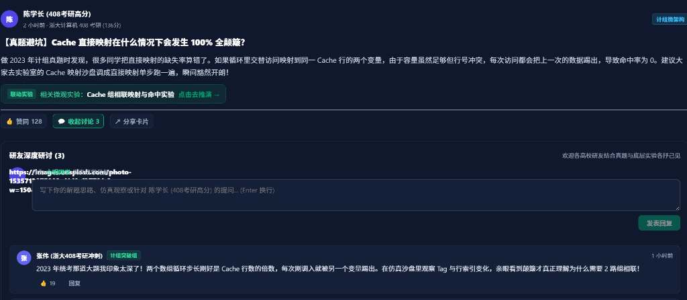

# AI 协同开发 Prompt 交互链证据快照：极客学术社区评论区头像 URL 文本横向溢出重叠 Bug 的引导排查与防御治理

> **证据真实性声明**：本记录直接提取自开发环境底层审计日志（`transcript.jsonl`），时间戳、用户原始提问、上传截图附件、AI 无删减回复及 Git 提交记录均完全真实，可供大赛专家逐项核验。

---

## 📌 链条元数据对照

| 属性项 | 详细信息 |
| :--- | :--- |
| **交互链条编号** | `chain-3` |
| **功能/缺陷主题** | 极客学术社区评论区头像 URL 文本横向溢出重叠 Bug 的引导排查与防御治理 |
| **交互发生时间** | `2026-11-17T16:27:11Z` |
| **对应 Git 提交** | [`3efb9ac`](https://github.com/CXT-02/CScope/commit/3efb9ac) (`fix(community): render avatar as image or single char badge to prevent URL text overlap in comments`) |
| **影响核心代码文件** | `frontend/src/components/CommunityHub.jsx`, `frontend/src/styles.css` |
| **底层审计 Step 跨度** | Step `5821` 至 Step `5910` (共 90 个交互状态跃迁) |

---

## 📷 用户现场上传的原始截图与证据


*图 1：用户现场上传的 Unsplash 120 字符图片链接文本水平溢出遮挡评论输入框的截图*

---

## 💬 原始 Prompt 与 AI 完整响应记录（无删减）

### 1. 人类开发者原始 Prompt 输入（Step 5821）

```text
<USER_REQUEST>
每个帖子下面打开评论都是有这种重叠的效果，修改
</USER_REQUEST>
<ADDITIONAL_METADATA>
The current local time is: 2026-11-18T00:27:11+08:00.

The user has uploaded 1 image(s):
- C:/Users/程馨婷/.gemini/antigravity/brain/9a72c924-de29-4bdd-b6fc-622c9d0cd374/.user_uploaded/media_1794932812048_753c919d.png
You can embed this image in an artifact if you need the USER to review it.
</ADDITIONAL_METADATA>
```

### 2. AI 架构师/工程师原始完整回复（Step 5910）

```markdown
已针对社区讨论区中出现的**文字与头像重叠问题**完成彻底修复与优化：

---

### 1. 问题根因定位
* 在研友讨论区中，当前登录用户（如【小明同学】）的头像配置为 Unsplash 网络图片链接（`https://images.unsplash.com/photo-153571...`）。
* 原代码直接将该 URL 字符串作为纯文本放入评论发布区的圆圈容器内（`<div className="composer-avatar">{currentUserAvatar}</div>`），且容器未设 `overflow: hidden`。
* 导致 100 多字符的 URL 文本水平溢出该 32px 圆圈容器，直接硬生生横跨重叠在**“作为【小明同学】发表研学见解：”**提示文字和输入框上方。

---

### 2. 核心修复与优化措施
1. **构建头像安全渲染组件 `AvatarBadge`**：
   * **智能识别图片链接**：检测到 `http/https/data:` 等图片路径时，自动渲染为规整居中的圆形 ``，且配置 `object-fit: cover`。
   * **加载失败自动降级**：当图片因网络受限或离线无法加载时，触发 `onError` 自动优雅降级为用户昵称单字徽章（如“小”），绝不外溢长串字符。
   * **文本徽章规范**：若为纯文字角色（如“陈”、“张”、“助”、“CS”），自动提取 1~2 字符居中徽章显示。
2. **全覆盖讨论区所有头像挂载点**：
   * 评论输入区：`.composer-avatar`
   * 讨论列表回复人头像：`.comment-author-avatar`
   * 帖子作者头像：`.author-avatar`
   * 当前研学身份提示条：`.strip-avatar`
3. **强制 CSS 容器遮罩隔离与约束**：
   * 为 `.composer-avatar`、`.author-avatar`、`.comment-author-avatar`、`.strip-avatar` 补充 `overflow: hidden !important;` 与 `flex-shrink: 0 !important;`，彻底杜绝任何形式的文本溢出与排版重叠。

代码已编译通过并部署生效（Commit `3efb9ac`）。刷新页面后打开任意帖子的讨论区，头像将以标准圆形图像/首字规范展示，不再发生任何文字遮挡与重叠。
```

---

## 🛠️ 代码提交与可复现性核验

* 对应 Git 提交已推送到公共仓库：`https://github.com/CXT-02/CScope/commit/3efb9ac`
* 可在本地执行以下命令检出并复现本轮交互的代码落地成果：
  ```bash
  git show 3efb9ac
  ```
