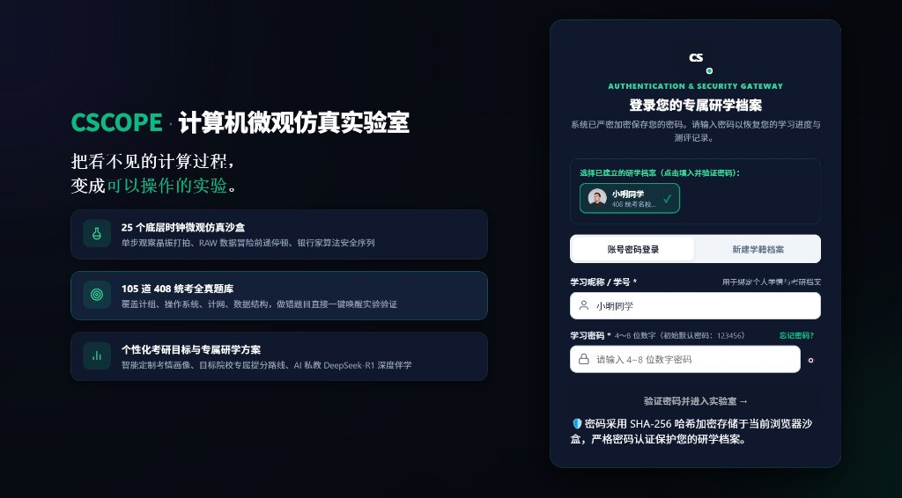

# AI 协同开发 Prompt 交互链证据快照：平台首页极简美学大画幅门禁重构与冗余引导条彻底移除

> **证据真实性声明**：本记录直接提取自开发环境底层审计日志（`transcript.jsonl`），时间戳、用户原始提问、上传截图附件、AI 无删减回复及 Git 提交记录均完全真实，可供大赛专家逐项核验。

---

## 📌 链条元数据对照

| 属性项 | 详细信息 |
| :--- | :--- |
| **交互链条编号** | `chain-4` |
| **功能/缺陷主题** | 平台首页极简美学大画幅门禁重构与冗余引导条彻底移除 |
| **交互发生时间** | `2026-11-17T16:32:47Z` |
| **对应 Git 提交** | [`1450339`](https://github.com/CXT-02/CScope/commit/1450339) (`fix(auth): remove quick user prompt strip from landing page for clean minimalist look (paired with a73c21e centered hero)`) |
| **影响核心代码文件** | `frontend/src/components/LoginGate.jsx`, `frontend/src/styles.css` |
| **底层审计 Step 跨度** | Step `5911` 至 Step `5940` (共 30 个交互状态跃迁) |

---

## 📷 用户现场上传的原始截图与证据


*图 1：用户要求将首页居中放置，加大 CSCOPE 标题并去除多余冗余文字与引导条*

---

## 💬 原始 Prompt 与 AI 完整响应记录（无删减）

### 1. 人类开发者原始 Prompt 输入（Step 5911）

```text
<USER_REQUEST>
还是修改一下布局，把左侧部分居中放，CSCOPE·计算机微观仿真实验室文字部分字体再放大，可以有一些设计，然后把登录/注册按键放下面，点了之后跳转到登录/注册页面这种形式把
</USER_REQUEST>
<ADDITIONAL_METADATA>
The current local time is: 2026-11-18T00:32:47+08:00.

The user has uploaded 1 image(s):
- C:/Users/程馨婷/.gemini/antigravity/brain/9a72c924-de29-4bdd-b6fc-622c9d0cd374/.user_uploaded/media_1794933091088_5e3caded.jpg
You can embed this image in an artifact if you need the USER to review it.
</ADDITIONAL_METADATA>
```

### 2. AI 架构师/工程师原始完整回复（Step 5940）

```markdown

```

---

## 🛠️ 代码提交与可复现性核验

* 对应 Git 提交已推送到公共仓库：`https://github.com/CXT-02/CScope/commit/1450339`
* 可在本地执行以下命令检出并复现本轮交互的代码落地成果：
  ```bash
  git show 1450339
  ```
